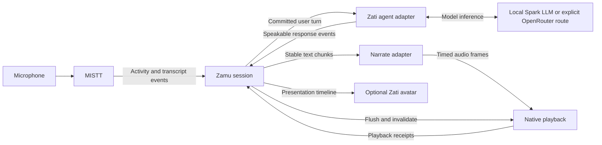

<!-- Non-authoritative historical snapshot; do not execute. Maintained plan: ../../plan.md -->
# Zamu — Complete Architecture and Delivery Plan

Status: Planning draft. Implementation has not been started by this document.

This standalone Desktop document contains the complete RFC followed by a dependency-linked delivery checklist. It covers MISTT, Zamu, Narrate, Zati, local open-weight inference on DGX Spark, optional OpenRouter adapters, friendly voice craft, and a future talking avatar.

The architecture below is a snapshot of `zamu/docs/rfc/rfc-001.md` taken when this document was created. The repository RFC remains the architecture source; this Desktop copy does not automatically track later edits. The checklist is proposed future work, not evidence of completion or authorization to publish or deploy.

Execution: direct engineering implementation in scoped repository worktrees, preserving the selected session model and permissions. Platform audio acceptance requires a Mac; Spark inference qualification requires admitted local capacity. No remote execution route is qualified by this plan. Owners below are responsibility roles, not assigned workers. Estimates remain TBD until contract and runtime preflight. All implementation acceptance includes proportionate tests and repository-required checks.

Document validation: task IDs and dependencies checked locally; independent content review recorded below. Portable Wazi conformance is not claimed: the required `wazi-contract` executable is not available on PATH. This is a readable delivery draft, not an admitted executable lifecycle.

---

## Architecture: RFC-001: Zamu — interruptible voice conversations for AI tools

- Status: Draft for owner review
- Date: 2026-10-13
- First consumer: Zati
- Primary operating environment: personal use with open-weight models on a local DGX Spark
- Implementation language: Go for the embeddable coordinator and adapters; model inference and native audio remain separate runtimes

### 1. Purpose

Zamu gives an existing AI tool a natural voice conversation interface. A person can speak, hear a response, interrupt it, and receive an updated response when they finish their turn. Listening continues while the assistant speaks.

Zamu means “turn.” Its responsibility is conversational coordination: deciding when to yield, when to respond, and which output is still valid. MISTT hears, Zamu coordinates, Narrate speaks, and the host agent acts.

The first integration is Zati. The owner's primary use will run inference locally on a DGX Spark using open-weight models. OpenRouter is an optional backend choice. A future talking Zati avatar must use the same conversation and playback timeline, so its mouth, expressions, and listening behavior agree with what the user actually hears.

Zati should feel friendly, attentive, and easy to interrupt. Its identity and friendly system prompt are being developed separately. This RFC defines how voice craft consumes that work without creating a competing persona or changing the authority of the underlying agent.

### 2. Goals and exclusions

#### Goals

1. Provide a Go library that can be embedded in Zati and other AI tools without a web UI or mandatory hosted coordinator.
2. Reuse MISTT for listening and transcription, and Narrate for synthesis.
3. Support simultaneous listening and playback, prompt interruption, and automatic turn-taking.
4. Keep the host's existing conversation, tools, permissions, task execution, and memory authoritative.
5. Make local-only operation explicit and prevent silent cloud fallback.
6. Support long personal sessions with bounded buffering, explicit recovery, and measurable latency.
7. Preserve the distinction between generated text, synthesized audio, and audio actually heard.
8. Establish optional timing and presentation interfaces for a future talking avatar.

#### Exclusions from the first delivery

- A new agent framework, model router, memory store, or task scheduler.
- Training speech or language models, or implementing GPU inference in Go.
- A standalone web application, telephony platform, or multi-party meeting assistant.
- Automatic speaker identification, emotional diagnosis, or instructions inferred from ambient conversation.
- Photorealistic video generation or a lip-sync model in the core library.
- Claims that interruption cancels or reverses external actions.

### 3. Existing building blocks and gaps

These are source observations from the design session, not claims of installed or live acceptance. Dependency revisions must be pinned and rechecked during implementation.

| Block | Observed capability | Required evolution |
| --- | --- | --- |
| MISTT | Go module and gRPC transcription stream; source labels, segment identity, finality, timestamps, session and gap events | Speech activity events; finalized recognition coverage; explicit microphone-only capture mode; conversational latency qualification |
| Narrate | Public OpenRouter speech client returning audio bytes; Pocket workflow with paragraph-level early playback | Public cancellable incremental audio interface suitable for short conversational phrases; persistent local inference adapter |
| Zati | Native speech-start detection, silence-based utterance capture, automatic transcript submission, interruptible playback, Narrate dependency | MISTT input adapter, Zamu session integration, local speech configuration, playback receipts, preserved authority and accounting |
| Spark inference | Deployment target for local models | Qualified simultaneous STT, LLM, and TTS configuration with bounded resources and measured latency |

MISTT's inspected interface does not expose explicit speech-start or semantic end-of-turn events. Its paired microphone/selected-app contract must not be silently treated as microphone-only. Zati's existing native path supplies useful behavior but is not yet a reusable Zamu implementation. Narrate's completed-byte and paragraph workflows do not establish continuous PCM output.

### 4. Architecture and ownership



#### MISTT: observation

MISTT owns device capture, source provenance, recognition, and speech activity observations. Zamu consumes its public interface rather than importing private packages or opening a second microphone capture path.

Required observations are `SpeechStarted`, `SpeechStopped`, `TranscriptUpdated`, `TranscriptFinal`, `RecognitionProgress`, `SessionStarted`, `SessionStopped`, and `Gap`. Speech activity events identify source, session, sequence, and capture time. Transcript revisions retain stable segment identity. Finality means a segment will not change; it does not mean the human has yielded the conversational turn.

`RecognitionProgress` supplies a finalized-through capture offset scoped to the admitted source and stream identity. It guarantees that all recognition results through that offset have been delivered and finalized, including intervals with no recognized text. It must not advance across an unresolved gap. A final segment, the latest transcript timestamp, or elapsed silence alone cannot establish this guarantee. Recognition and activity offsets must share a capture timeline so the coordinator can compare recognition coverage with an endpoint. Adapters that cannot establish complete coverage cannot support automatic turn commitment.

Microphone-only mode must be an explicit MISTT capability with its own admission and tests. Existing paired capture semantics remain explicit. For the first Zati integration, only the admitted microphone source can produce human turns. Other captured audio is not automatically an instruction source.

#### Zamu: coordination

Zamu owns turn assembly, endpointing policy, interruption, response generations, queue limits, and conversational playback accounting. It neither executes tools nor maintains a second authoritative chat history.

Turn detection and playback contracts begin as packages in the Zamu module. They do not need independent products or repositories. Provider and host integrations sit behind interfaces so other applications can embed the same coordinator.

#### Narrate: synthesis and delivery craft

Narrate converts stable, host-approved speech text into audio. It reports format and timing capabilities and honors cancellation. Its conversational path must not require a new remote rendering job, file transfer, or full-response rewrite for every utterance.

Synthesis should preserve voice continuity across chunks. Chunking balances first-audio latency with natural phrasing; emitting every token independently is not acceptable speech craft.

#### Host agent: meaning and authority

Zati owns identity, context, permissions, tool calls, task cancellation, memory, and durable conversation records. Its adapter accepts committed human turns and produces speakable reply events plus task/proposal status. Only content explicitly designated for speech may reach Narrate; reasoning traces, raw tool arguments, and arbitrary internal events are excluded.

Zamu can invalidate a spoken response without cancelling an independent task. The adapter must state whether a cancellation applies to response generation, a proposed action, or a running task. Unknown task outcomes remain unknown.

#### Native media adapter

The local media adapter owns speaker output, immediate queue flushing, playback progress, and platform audio integration. Echo cancellation belongs close to capture/playback, where a playback reference is available. Muting input and stopping output are separate operations.

### 5. Proposed Go contracts

The following is an API sketch, not implemented source or a frozen compatibility commitment:

```go
type Components struct {
    Listener Listener
    Turns    TurnDetector
    Agent    Agent
    Speech   Synthesizer
    Player   Player
    Avatar   Presenter // optional; failure must not block voice
}

func New(cfg Config, deps Components) (*Session, error)
func (s *Session) Run(ctx context.Context) error
func (s *Session) Events() <-chan Event
func (s *Session) Interrupt(ctx context.Context) error
func (s *Session) Close(ctx context.Context) error
```

Construction performs validation only. Explicit start owns I/O and goroutines. Cancellation closes owned resources within a configured deadline and reports incomplete cleanup. Every stream has an explicit terminal result; channel closure alone cannot ambiguously represent success or failure.

| Boundary | Input | Output / guarantees |
| --- | --- | --- |
| Listener | Authorized capture subscription | Ordered activity/transcript events, revisions, finalized recognition coverage, gaps, terminal result |
| TurnDetector | Activity, transcript context, elapsed silence | Provisional endpoint, revoked endpoint, committed turn; reasons and confidence where meaningful |
| Agent | Turn ID, text, conversation binding, prior playback receipt | Response ID, stable speech text, completion/failure, host-owned task status |
| Synthesizer | Response generation, ordered stable text chunks, voice craft | Bounded audio frames, explicit format, optional text/audio alignment, terminal result |
| Player | Audio frames and generation | Actual playback cursor, completion, flush acknowledgement |
| Presenter | Presentation events on the playback timeline | Optional readiness/errors; no authority over voice or agent execution |

Audio format includes encoding, sample rate, channels, and sample count. Adapters negotiate or explicitly resample; they never reinterpret bytes at a different rate. Core playback uses timestamped PCM frames. Transport compression may be an adapter concern.

Events carry session ID, turn ID where applicable, response generation, sequence, and a monotonic media offset. Wall-clock time may be included for diagnostics but is not the synchronization clock. Typed errors distinguish unsupported capability, authorization failure, overload, transport failure, and uncertain provider execution.

### 6. Turn-taking and interruption

Listening remains active across all output states. Output progresses through idle, generating, speaking, interrupted, completed, or failed. The listener has its own lifecycle; a single state enum must not make listening and speaking mutually exclusive.

#### Normal turn

1. Admit the explicitly started voice session and selected microphone source.
2. Assemble partial/final transcript revisions without duplicating text.
3. Detect a candidate end of turn from speech activity and context.
4. Revoke the candidate if speech resumes before commitment.
5. Wait for finalized recognition coverage through the candidate endpoint, with no unresolved gap in the utterance. Speech resuming during this wait still revokes the candidate.
6. Commit the complete finalized text as one user turn with a stable ID and submit it once to the host.
7. Synthesize stable reply chunks while the agent continues generating.
8. Play ordered audio and report heard progress to the host.

The first detector may use configurable silence and transcript context. A semantic detector is pluggable. Model-assisted endpointing must have a bounded deadline and an explicit fallback policy. Silence alone is not proof of completion in every case; unfinished phrases, hesitations, and deliberate pauses belong in acceptance fixtures.

Endpoint acceptance and transcript completeness are separate prerequisites for commitment. The recognition wait has a configured deadline; expiry invalidates the uncommitted utterance and requests a repeat rather than submitting partial text. Late results for an invalidated utterance are quarantined and cannot enter the next turn. A result that changes text already covered by a finalized-through offset is a listener contract failure: suspend automatic commitment and report it to the host. Do not silently edit or resubmit an already committed turn; host-owned actions may already have begun.

#### Interruption

1. Local speech detection requests immediate playback suppression without waiting for a network round trip.
2. Zamu increments the response generation and flushes queued audio; late frames and avatar cues from older generations are rejected.
3. Cancel obsolete synthesis and response production where supported. Closing a client stream does not prove remote compute or billing stopped.
4. Retain the actual played boundary and the interrupted status of the response.
5. Continue capturing and assembling the human's interruption.
6. After the new turn is committed, ask the host for an updated response.

An interrupted answer is not automatically resumed. “Keep going” is interpreted by the host using context and heard progress. A false speech trigger must not silently replay stale audio; recovery is an explicit policy. Support a brief provisional playback pause before confirmed cancellation if the chosen detector can reliably distinguish noise and backchannels. First delivery may conservatively yield to all confirmed human speech.

Natural backchannels such as “mm-hmm” versus substantive interruption are an extension, not an assumed first-release capability. The user must always be able to force interruption explicitly.

#### Playback truth

Track generated, synthesized, queued, and played progress separately. Word-level heard text requires alignment evidence. Without alignment, report phrase boundaries or sample progress with declared uncertainty. Preserve the complete generated record if the host needs it, but do not represent unheard text as successfully delivered.

### 7. Friendly Zati and voice craft

Zati's host-owned persona remains the single source of identity and conversational behavior. The parallel system-prompt work supplies a versioned voice-compatible style contract; Zamu and Narrate consume it rather than maintaining another system prompt.

Separate three concerns:

- **Content craft, owned by Zati:** friendly wording, concise spoken answers, relevant acknowledgements, useful follow-up questions, and honest descriptions of work.
- **Delivery craft, consumed by Narrate:** voice identity, pronunciation, pace, pauses, warmth, and supported prosody instructions.
- **Interaction craft, owned by Zamu:** yielding promptly, allowing thinking pauses, avoiding repeated greetings, and recovering gracefully from interruptions.

The style contract should carry a revision, language, stable voice identity, pace preference, pronunciation overrides, and supported delivery hints. Provider capability negotiation must identify unsupported hints rather than pretending they were applied. Do not create an emotion-inference requirement from microphone input.

Default conversational behavior:

1. Use natural, brief openings; give the useful answer early.
2. Prefer speech-sized phrases and offer more detail when appropriate.
3. After an interruption, address the new input without scolding, repeated apologies, or restarting the entire answer.
4. Avoid filler on every tool call. A short status acknowledgement is appropriate only when grounded in actual host state.
5. Preserve exact amounts, names, approvals, and execution outcomes. Voice polish must not change their meaning.
6. Do not vocalize Markdown syntax, raw URLs, stack traces, or large tables by default; the host supplies an appropriate spoken form while retaining the original visible content.
7. Keep synthetic identity honest. Friendly presentation does not authorize claims of human feelings, experiences, or completed actions.

Verbatim text and approval prompts can disable rewriting. Style changes are pinned per response, preventing a mid-utterance persona or voice switch. The prompt session and voice implementation should agree on sample exchanges covering greeting, useful disagreement, interruption, uncertainty, errors, and tool progress before persona acceptance.

### 8. Future talking Zati avatar

Avatar support is a presentation extension of the same session, not a separate conversational agent. The voice-only path ships first, but its event schema must preserve the timing needed for a convincing avatar.

#### Presentation contract

Expose listening, thinking, speaking, interrupted, idle, and unavailable states, plus optional host-approved expression hints. States report actual activity: “speaking” begins with playback, not when synthesis starts.

Audio playback is the master clock. Audio frames carry sample offsets and response generation. Optional alignment associates text, phonemes, or visemes with intervals on that timeline. If the TTS backend lacks alignment, a separate audio-to-viseme adapter may provide it; text alone cannot establish exact mouth timing.

Every visual cue carries the same generation fence as audio. On interruption, flush pending speech animation and transition to listening at the acknowledged playback stop. Buffering pauses the mouth timeline; resumed playback resumes from the actual cursor. Dropped visual frames must not delay audio or accumulate stale animation.

#### Progressive implementation

1. **Stateful avatar:** attentive listening, thinking, and speaking states with restrained expressions. This is not claimed as lip sync.
2. **Synchronized avatar:** visemes driven by synthesized audio/alignment and the actual playback clock.
3. **Richer rendering:** optional higher-fidelity face or video generation, admitted only when it meets latency and resource limits alongside the voice models.

The renderer may live in Zati's native UI or a separate process. Zamu remains usable without graphics dependencies. When the avatar fails or exceeds its budget, degrade to voice with an idle/static visual. Never hold a spoken answer waiting for a video render.

Visual acceptance requires watching and listening to the actual output, including interruptions. A present animation file, running renderer, or generated viseme list is not evidence of convincing lip sync. Provide motion-reduction and voice-only options.

### 9. Local-first inference and backend profiles

#### Primary: local Spark

- Capture/playback stay on the user's computer.
- MISTT supplies its admitted local recognition service.
- Zati uses an open-weight LLM served on Spark through its existing model boundary.
- Narrate uses a persistent local streaming TTS service; Pocket TTS is the initial candidate to qualify.
- Turn detection runs locally with bounded CPU or model resources.
- No audio, transcript, or synthesis request falls back to a cloud provider automatically.

“Local” means inference within the explicitly configured local system, including the Spark over the private network. It does not automatically make every Zati tool, memory service, or external action offline. The host must disclose and govern those separately.

Keep inference services warm during an active session. Manage service deployment through the owner's approved Spark workload mechanism, with pinned images/models and resource reservations. Zamu connects to services; it does not silently install models or allocate the whole device.

Pocket TTS is a candidate because its upstream documents CPU execution and streaming. CPU placement may reduce GPU contention, but must be measured on the chosen host. Do not assume the existing Narrate batch deployment or Unmute's x86_64 deployment is a qualified Spark conversational runtime.

Benchmark candidate LLMs with STT and TTS active. Prefer responsive first-token generation and sustained audio production over maximum parameter count. Reserve capacity for recognition and synthesis; avatar work must yield to the voice path. Record quantization, context size, concurrency, model revision, and serving runtime with every result.

#### Optional profiles

| Profile | Recognition | Reasoning | Synthesis |
| --- | --- | --- | --- |
| Local-only | MISTT/local | Zati/local Spark model | Narrate/local |
| Hybrid | MISTT/local | Zati/OpenRouter | Narrate/local or explicitly selected OpenRouter |
| Hosted speech | Explicit hosted listener adapter | Host-selected model | Explicit hosted synthesis adapter |

Provider capabilities are not interchangeable. OpenRouter's documented utterance transcription and audio output interfaces do not by themselves establish continuous input transcription, semantic endpoint events, or a full-duplex session. An utterance-based adapter must label that limitation.

### 10. Zati integration

Zati embeds Zamu in the appropriate local runtime and connects native playback through its authenticated local transport. Keep the immediate media stop path local even if the agent controller is remote. Integration replaces the existing voice path incrementally, avoiding two simultaneous microphone owners.

Preserve current voice-session admission, conversation/generation binding, dedicated provider credentials, disclosure rules, accounting, and reply commitment semantics. A local backend needs an explicit configuration path; it must not be disguised as an OpenRouter credential or bypass checks through a fake endpoint.

Automatic turn submission is permitted only within an explicitly started voice session bound to the selected conversation and actor. Duplicate/replayed events cannot create repeated messages or tool execution. Scope changes, logout, and session expiry close admission and invalidate pending outputs.

Use the host's existing reply stream where possible. Preview text may be spoken only according to the host's explicit policy, with withdrawal and commitment semantics preserved. Zamu must not turn provisional output into a durable message or action approval.

### 11. Reliability, privacy, and resource limits

- Bound every audio/text queue by duration or bytes. Slow consumers trigger backpressure or explicit failure; never silently lose a committed human turn.
- On a transcript gap, pause automatic turn commitment and mark every overlapping uncommitted utterance as incomplete. Reusing an affected utterance requires recovery of the entire missing interval and finalized recognition coverage through its endpoint within a configured recovery deadline. Resumed events alone do not repair the gap. If recovery is unavailable or times out, invalidate the affected utterance, clear or quarantine its text and pending endpoint, and explicitly request a repeat. Resume assembly only at a fresh speech boundary after continuity is established; never concatenate pre-gap and post-gap fragments into a new instruction. After an unrecoverable gap, establish a new stream identity and capture baseline before resuming automatic commitment; old-stream events cannot advance its coverage. Fresh session admission must also clear or quarantine partial turns from the old stream. Do not fabricate missing words.
- Reconnect with new stream identity and explicit sequence reconciliation. Partial transcripts and tool submissions are not blindly replayed.
- Set maximum session and utterance durations. Long sessions use verified rollover or explicit renewal; bounded teardown must not produce duplicate final turns.
- Keep raw audio and transcripts out of default diagnostic logs. Retention is host-controlled and explicitly configured.
- Use explicit authenticated endpoints and credentials. No ambient credential discovery or cloud fallback in the core.
- Separate cancellation from retry safety. Ambiguous hosted calls may have executed and incurred cost; do not automatically repeat them.
- Avoid per-turn process/model startup. Release session resources on close while respecting separately managed shared inference services.

### 12. Acceptance and measurements

The numbers below are proposed engineering targets, not measured claims. Capture p50/p95, hardware/model configuration, network conditions, and failures. Report raw traces with distinct endpointing, inference, synthesis, and playback intervals.

| Area | Acceptance condition |
| --- | --- |
| Basic loop | A real microphone turn through MISTT reaches Zati, produces local model text, and plays local synthesized audio |
| Interruption | Speech-start event to confirmed playback stop targets p95 <= 150 ms on the local device; separately measure acoustic onset to detection |
| Turn response | Acoustic end of turn to first audible response targets p95 <= 1.5 s for short, non-tool turns on the selected warm local profile |
| Stale output | No old-generation audio or avatar cues are accepted after flush acknowledgement |
| Endpointing | Curated pauses, unfinished sentences, noise, and resumed speech produce recorded false-cutoff/missed-turn results; detector settings and acceptable thresholds are agreed before release |
| Transcript completeness | Delayed final segments and coverage events never permit premature submission; resumed speech revokes an endpoint while coverage is pending. Deadline expiry submits nothing and requests a repeat. Late results cannot contaminate a later turn, and revisions behind finalized coverage produce a contract failure without resubmission |
| Gap integrity | Inject a missing negation or condition mid-utterance. Resumed events alone never submit the remaining fragments; only verified complete recovery permits the original turn. Unrecoverable gaps request a repeat, and reconnect or fresh admission cannot reuse the affected text or endpoint |
| Agent authority | Interrupting speech never falsely reports tool cancellation; explicit cancellation uses the host's normal path |
| Heard context | Interruption receipts distinguish played and unheard output, with timing granularity stated |
| Session endurance | A two-hour conversation soak exercises configured renewal/rollover, repeated interruptions, bounded queues, and clean shutdown without monotonic session-owned resource growth |
| Local-only | With external egress blocked after model preparation, the selected voice/inference path works and does not attempt cloud fallback |
| Recovery | STT/TTS/LLM loss produces an honest state and bounded cleanup; reconnect cannot duplicate a user turn or external action |
| Audio environment | Headphone acceptance first; speakerphone acceptance additionally demonstrates echo handling and no repeated self-interruption |
| Friendly craft | Owner listens to representative exchanges and accepts warmth, pace, clarity, interruption recovery, and consistency with the host persona |
| Avatar extension | Visible/audio review demonstrates mouth alignment, buffering behavior, interruption, stale-cue rejection, and voice-only fallback |

Use deterministic event/clock tests for races, revisions, and generation fences; adapter contract tests for real wire formats; then actual microphone-to-speaker qualification. Passing simulated tests does not establish provider latency, native audio, or human acceptance.

### 13. Delivery sequence

This is architectural sequencing, not a governed implementation plan or authorization to deploy.

1. Confirm and pin MISTT, Narrate, and Zati integration contracts; agree on the persona/voice-craft handoff.
2. Implement Zamu's session state, event contracts, turn assembly, cancellation, generation fences, and playback receipts with deterministic fixtures.
3. Add MISTT speech activity, finalized recognition coverage, and microphone-only support and Narrate's public incremental local synthesis interface; qualify their narrow paths.
4. Integrate one real Zati conversation using MISTT and local Spark inference, with actual native playback and interruptions.
5. Qualify long sessions, speakerphone echo handling, recovery, and friendly delivery; measure model/resource combinations.
6. Add optional hosted adapters without changing local-only behavior.
7. Implement avatar states, then synchronized visemes, then consider richer rendering after visible acceptance.

Each step preserves source, contract, runtime, and human acceptance as separate evidence. No milestone is complete solely because source compiles or a UI control exists.

### 14. Decisions and remaining choices

#### Decisions established by this RFC

- Name: Zamu; embeddable Go library; first consumer: Zati.
- Reuse MISTT and Narrate rather than creating replacement speech products.
- Primary personal deployment uses local open-weight inference on Spark.
- The host agent retains identity, memory, tools, and authority.
- Friendliness spans host wording, synthesis delivery, and interruption etiquette.
- Avatar timing is designed into events now; rendering is optional and delivered later.

#### Choices to settle through integration and measurement

- Exact local LLM, recognition backend, TTS voice, and pinned inference revisions.
- Turn detector and language coverage; silence thresholds and semantic fallback behavior.
- Placement of CPU TTS and endpointing on the client versus Spark.
- Concrete Zati local transport and supported OS playback adapters.
- Final voice-craft schema agreed with the parallel system-prompt session.
- Avatar renderer, alignment provider, likeness, and visual style.

These choices do not justify replacing existing host boundaries or claiming compatibility before qualification.

### 15. References

- MISTT: `github.com/sirerun/MISTT`, especially `proto/mistt/v1/mistt.proto` and the capture contracts.
- Narrate: `github.com/narrate-it/narrate`, especially `speech/openrouter` and the Pocket streaming workflow.
- Zati: `github.com/zati-run/zati`, especially `internal/voice`, desktop voice mode, and native playback.
- [Unmute](https://github.com/kyutai-labs/unmute): reference for speech orchestration and interruption behavior.
- [Pocket TTS](https://github.com/kyutai-labs/pocket-tts): candidate local streaming synthesizer; upstream capabilities require target-host qualification.
- [OpenRouter transcription](https://openrouter.ai/docs/guides/overview/multimodal/stt) and [speech synthesis](https://openrouter.ai/docs/guides/overview/multimodal/tts): optional hosted adapter boundaries.

---

## Delivery checklist

All rows are pending. Dependencies indicate required outcomes. Cross-repository adapter development and candidate integration may use an explicitly pinned upstream candidate or stable fixture; this does not establish landed integration acceptance. A multi-repository batch reviews and lands each repository separately in upstream-first order, and release waits until all referenced dependencies are landed and reverified. Candidate pins must be replaced with landed versions before release.

### E1 — Contract and design freeze

fidelity: executable

- [ ] T1.1 Pin source revisions and reconcile interfaces  Owner: Integration owner  Est: TBD  kind: agent  stage: preflight  blocked-by: []  acc: [MISTT, Narrate, Zati and Zamu revisions are recorded; actual public APIs and current native behavior are inspected; gaps are documented]
- [ ] T1.2 Freeze conversation and media contracts  Owner: Integration owner  Est: TBD  kind: agent  stage: author  blocked-by: [T1.1]  acc: [Listener, turn, agent, synthesis, player and avatar event contracts define ordering, revisions, generations, timing, errors and cancellation]
- [ ] T1.3 Agree friendly persona and voice craft handoff  Owner: Voice craft owner  Est: TBD  kind: agent  stage: author  blocked-by: [T1.1]  acc: [Parallel prompt work supplies a versioned style contract and sample exchanges; Zati remains the only persona authority]

### E2 — Reusable Zamu coordinator

fidelity: executable

- [ ] T2.1 Implement sessions, turn assembly and generation fences  Owner: Zamu implementer  Est: TBD  kind: agent  stage: implement  blocked-by: [T1.2]  acc: [Deterministic tests demonstrate partial transcript replacement, exactly-once turn submission, candidate endpoint revocation, bounded queues and rejection of stale output]
- [ ] T2.2 Implement interruption and playback receipts  Owner: Zamu implementer  Est: TBD  kind: agent  stage: implement  blocked-by: [T2.1]  acc: [Interruption flushes playback and cancels obsolete response work; played progress and uncertain alignment are represented; task cancellation remains separate]
- [ ] T2.3 Implement capability negotiation and lifecycle recovery  Owner: Zamu implementer  Est: TBD  kind: agent  stage: implement  blocked-by: [T2.2]  acc: [Unsupported formats fail explicitly; disconnect, gaps, timeout and close paths terminate boundedly without silently replaying user turns]

### E3 — MISTT conversational input

fidelity: executable

- [ ] T3.1 Add explicit microphone-only admission and speech activity events  Owner: MISTT implementer  Est: TBD  kind: agent  stage: implement  blocked-by: [T1.2]  acc: [Real subscription exposes ordered speech-start, speech-stop and RecognitionProgress finalized-through coverage; microphone-only mode is explicit; delayed finals and gaps are tested and existing paired behavior remains tested]
- [ ] T3.2 Implement Zamu MISTT adapter  Owner: Zamu implementer  Est: TBD  kind: agent  stage: implement  blocked-by: [T3.1, T2.1]  acc: [Adapter handles source filtering, segment revisions, RecognitionProgress finalized-through coverage, gaps and terminal errors through the real gRPC contract; delayed-final tests prevent premature commitment and no second microphone is opened]

### E4 — Narrate conversational synthesis

fidelity: executable

- [ ] T4.1 Add public incremental synthesis API and local backend  Owner: Narrate implementer  Est: TBD  kind: agent  stage: implement  blocked-by: [T1.2]  acc: [Stable text chunks produce incremental PCM with format and generation identity; cancellation works; warm service avoids per-turn job and file-transfer startup]
- [ ] T4.2 Integrate voice craft and synthesis adapter  Owner: Narrate implementer  Est: TBD  kind: agent  stage: implement  blocked-by: [T4.1, T1.3, T2.2]  acc: [Voice and style are pinned per response; phrasing stays natural; unsupported prosody is explicit; factual and verbatim speech text remains unchanged]

### E5 — Spark inference qualification

fidelity: executable

- [ ] T5.1 Inspect capacity and select bounded model candidates  Owner: Runtime owner  Est: TBD  kind: agent  stage: preflight  blocked-by: [T1.1]  acc: [Current Spark availability, competing workloads, model licenses, ARM64 runtime support and resource limits are recorded without displacing unrelated workloads]
- [ ] T5.2 Prepare reproducible local runtime manifests  Owner: Runtime owner  Est: TBD  kind: agent  stage: implement  blocked-by: [T5.1, T4.1]  acc: [Pinned STT, LLM and TTS configurations declare health, auth, warmup, limits, lifecycle and rollback using the approved workload mechanism]
- [ ] T5.3 Qualify simultaneous local inference  Owner: Runtime owner  Est: TBD  kind: agent  stage: verify  blocked-by: [T5.2]  acc: [Authorized bounded qualification measures cold and warm latency with all voice models active; exact revisions, resources and failures are recorded]

### E6 — First Zati voice integration

fidelity: executable

- [ ] T6.1 Integrate host agent and conversation adapter  Owner: Zati implementer  Est: TBD  kind: agent  stage: implement  blocked-by: [T2.3, T3.2, T4.2]  acc: [Voice turns use the existing conversation and reply stream; admission, credentials, accounting, approvals and provisional reply semantics remain enforced]
- [ ] T6.2 Integrate native playback and immediate interruption  Owner: Zati implementer  Est: TBD  kind: agent  stage: implement  blocked-by: [T6.1]  acc: [Native PCM playback acknowledges actual progress and flush; microphone capture has one owner; local speech-start stops sound without waiting for the controller]
- [ ] T6.3 Qualify real microphone-to-speaker conversation  Owner: Acceptance owner  Est: TBD  kind: agent  stage: verify  blocked-by: [T6.2, T5.3]  acc: [Installed candidate completes a local conversation and repeated mid-response interruptions with no stale audio; source and installed revision are identified]

### E7 — Personal daily-use acceptance

fidelity: executable

- [ ] T7.1 Qualify turn detection and speakerphone echo handling  Owner: Audio owner  Est: TBD  kind: agent  stage: verify  blocked-by: [T6.3]  acc: [Recorded pause, noise and unfinished-sentence cases meet agreed cutoff thresholds; headphone and speakerphone outcomes are reported separately]
- [ ] T7.2 Qualify endurance, privacy and recovery  Owner: Acceptance owner  Est: TBD  kind: agent  stage: verify  blocked-by: [T6.3]  acc: [Two-hour soak covers rollover, interruption and model loss; buffers remain bounded; egress-blocked voice inference works; recovery creates no duplicate turn or action]
- [ ] T7.3 Accept friendly conversational delivery  Owner: Owner  Est: TBD  kind: human  stage: verify  blocked-by: [T1.3, T7.1]  acc: [Owner hears and accepts greetings, interruptions, disagreement, errors and tool-progress examples for warmth, pace, clarity and persona consistency]

### E8 — Optional hosted adapters

fidelity: executable

- [ ] T8.1 Add explicitly selected OpenRouter speech profiles  Owner: Adapter implementer  Est: TBD  kind: agent  stage: implement  blocked-by: [T4.2, T6.3]  acc: [Hosted configuration declares capabilities and credentials; utterance transcription is not called continuous recognition; local-only mode cannot silently fall back]
- [ ] T8.2 Qualify hosted interruption and provider uncertainty  Owner: Acceptance owner  Est: TBD  kind: agent  stage: verify  blocked-by: [T8.1]  acc: [Authorized provider checks report actual latency and cancellation behavior; uncertain execution is not blindly retried or reported as free]

### E9 — Future talking Zati avatar

fidelity: executable

- [ ] T9.1 Choose avatar style and renderer within resource budget  Owner: Avatar owner  Est: TBD  kind: agent  stage: author  blocked-by: [T7.3]  acc: [Owner accepts a visual direction and renderer choice; identity, reduced-motion behavior and voice-only fallback are specified]
- [ ] T9.2 Implement stateful avatar presentation  Owner: Avatar implementer  Est: TBD  kind: agent  stage: implement  blocked-by: [T9.1, T6.2]  acc: [Listening, thinking and speaking reflect actual state; failure does not block audio; state animation is not represented as lip sync]
- [ ] T9.3 Implement audio-aligned mouth movement  Owner: Avatar implementer  Est: TBD  kind: agent  stage: implement  blocked-by: [T9.2]  acc: [Alignment or audio-to-viseme cues follow playback sample position and generation; flush, pause and resume preserve synchronization]
- [ ] T9.4 Qualify avatar realism and interruption  Owner: Owner  Est: TBD  kind: human  stage: verify  blocked-by: [T9.3]  acc: [Owner watches and hears actual output; lip alignment, immediate listening transition, stale-cue rejection, resource contention and fallback pass recorded acceptance]

## Review and delivery gates for coding batches

These gates are obligations for future code delivery, not Git stages for this Desktop document. Each changed repository gets its own exact-head review and landing receipt, even when a batch spans repositories. Implementation members per batch are bounded by ownership and accepted contracts. A single reviewer may cover a coherent batch only if every changed revision is identified. Review findings require stable fix, affected-verification and re-review rows before merging.

### B1 — Zamu core

Scope: T2.1, T2.2, T2.3.

- [ ] T11.1 Verify candidate  Owner: Integration owner  Est: TBD  kind: agent  stage: verify  blocked-by: [T2.1, T2.2, T2.3]  acc: [Changed-behavior tests, formatting, race checks where relevant and required repository gates pass on each exact candidate revision]
- [ ] T11.2 Independent code review  Owner: Independent reviewer  Est: TBD  kind: agent  stage: review  blocked-by: [T11.1]  acc: [Independent reviewer records base and head SHAs, covered scope and findings; all blocking findings are resolved and re-reviewed]
- [ ] T11.3 Merge reviewed candidates  Owner: Integration owner  Est: TBD  kind: agent  stage: merge  blocked-by: [T11.2]  acc: [Only exact approved heads merge under repository policy and required checks; landed SHAs are recorded]
- [ ] T11.4 Verify landed revisions  Owner: Integration owner  Est: TBD  kind: agent  stage: verify-landed  blocked-by: [T11.3]  acc: [Target branches contain the reviewed changes and focused checks pass on the landed revisions]

### B2 — MISTT and input adapter

Scope: T3.1, T3.2.

- [ ] T12.1 Verify candidate  Owner: Integration owner  Est: TBD  kind: agent  stage: verify  blocked-by: [T3.1, T3.2]  acc: [Changed-behavior tests, formatting, race checks where relevant and required repository gates pass on each exact candidate revision]
- [ ] T12.2 Independent code review  Owner: Independent reviewer  Est: TBD  kind: agent  stage: review  blocked-by: [T12.1]  acc: [Independent reviewer records base and head SHAs, covered scope and findings; all blocking findings are resolved and re-reviewed]
- [ ] T12.3 Merge reviewed candidates  Owner: Integration owner  Est: TBD  kind: agent  stage: merge  blocked-by: [T12.2]  acc: [Only exact approved heads merge under repository policy and required checks; landed SHAs are recorded]
- [ ] T12.4 Verify landed revisions  Owner: Integration owner  Est: TBD  kind: agent  stage: verify-landed  blocked-by: [T12.3]  acc: [Target branches contain the reviewed changes and focused checks pass on the landed revisions]

### B3 — Narrate and craft

Scope: T4.1, T4.2.

- [ ] T13.1 Verify candidate  Owner: Integration owner  Est: TBD  kind: agent  stage: verify  blocked-by: [T4.1, T4.2]  acc: [Changed-behavior tests, formatting, race checks where relevant and required repository gates pass on each exact candidate revision]
- [ ] T13.2 Independent code review  Owner: Independent reviewer  Est: TBD  kind: agent  stage: review  blocked-by: [T13.1]  acc: [Independent reviewer records base and head SHAs, covered scope and findings; all blocking findings are resolved and re-reviewed]
- [ ] T13.3 Merge reviewed candidates  Owner: Integration owner  Est: TBD  kind: agent  stage: merge  blocked-by: [T13.2]  acc: [Only exact approved heads merge under repository policy and required checks; landed SHAs are recorded]
- [ ] T13.4 Verify landed revisions  Owner: Integration owner  Est: TBD  kind: agent  stage: verify-landed  blocked-by: [T13.3]  acc: [Target branches contain the reviewed changes and focused checks pass on the landed revisions]

### B4 — Spark manifests

Scope: T5.2.

- [ ] T14.1 Verify candidate  Owner: Integration owner  Est: TBD  kind: agent  stage: verify  blocked-by: [T5.2]  acc: [Changed-behavior tests, formatting, race checks where relevant and required repository gates pass on each exact candidate revision]
- [ ] T14.2 Independent code review  Owner: Independent reviewer  Est: TBD  kind: agent  stage: review  blocked-by: [T14.1]  acc: [Independent reviewer records base and head SHAs, covered scope and findings; all blocking findings are resolved and re-reviewed]
- [ ] T14.3 Merge reviewed candidates  Owner: Integration owner  Est: TBD  kind: agent  stage: merge  blocked-by: [T14.2]  acc: [Only exact approved heads merge under repository policy and required checks; landed SHAs are recorded]
- [ ] T14.4 Verify landed revisions  Owner: Integration owner  Est: TBD  kind: agent  stage: verify-landed  blocked-by: [T14.3]  acc: [Target branches contain the reviewed changes and focused checks pass on the landed revisions]

### B5 — Zati integration

Scope: T6.1, T6.2.

- [ ] T15.1 Verify candidate  Owner: Integration owner  Est: TBD  kind: agent  stage: verify  blocked-by: [T6.1, T6.2]  acc: [Changed-behavior tests, formatting, race checks where relevant and required repository gates pass on each exact candidate revision]
- [ ] T15.2 Independent code review  Owner: Independent reviewer  Est: TBD  kind: agent  stage: review  blocked-by: [T15.1]  acc: [Independent reviewer records base and head SHAs, covered scope and findings; all blocking findings are resolved and re-reviewed]
- [ ] T15.3 Merge reviewed candidates  Owner: Integration owner  Est: TBD  kind: agent  stage: merge  blocked-by: [T15.2]  acc: [Only exact approved heads merge under repository policy and required checks; landed SHAs are recorded]
- [ ] T15.4 Verify landed revisions  Owner: Integration owner  Est: TBD  kind: agent  stage: verify-landed  blocked-by: [T15.3]  acc: [Target branches contain the reviewed changes and focused checks pass on the landed revisions]

### B6 — Hosted adapters

Scope: T8.1.

- [ ] T16.1 Verify candidate  Owner: Integration owner  Est: TBD  kind: agent  stage: verify  blocked-by: [T8.1]  acc: [Changed-behavior tests, formatting, race checks where relevant and required repository gates pass on each exact candidate revision]
- [ ] T16.2 Independent code review  Owner: Independent reviewer  Est: TBD  kind: agent  stage: review  blocked-by: [T16.1]  acc: [Independent reviewer records base and head SHAs, covered scope and findings; all blocking findings are resolved and re-reviewed]
- [ ] T16.3 Merge reviewed candidates  Owner: Integration owner  Est: TBD  kind: agent  stage: merge  blocked-by: [T16.2]  acc: [Only exact approved heads merge under repository policy and required checks; landed SHAs are recorded]
- [ ] T16.4 Verify landed revisions  Owner: Integration owner  Est: TBD  kind: agent  stage: verify-landed  blocked-by: [T16.3]  acc: [Target branches contain the reviewed changes and focused checks pass on the landed revisions]

### B7 — Avatar states

Scope: T9.2.

- [ ] T17.1 Verify candidate  Owner: Integration owner  Est: TBD  kind: agent  stage: verify  blocked-by: [T9.2]  acc: [Changed-behavior tests, formatting, race checks where relevant and required repository gates pass on each exact candidate revision]
- [ ] T17.2 Independent code review  Owner: Independent reviewer  Est: TBD  kind: agent  stage: review  blocked-by: [T17.1]  acc: [Independent reviewer records base and head SHAs, covered scope and findings; all blocking findings are resolved and re-reviewed]
- [ ] T17.3 Merge reviewed candidates  Owner: Integration owner  Est: TBD  kind: agent  stage: merge  blocked-by: [T17.2]  acc: [Only exact approved heads merge under repository policy and required checks; landed SHAs are recorded]
- [ ] T17.4 Verify landed revisions  Owner: Integration owner  Est: TBD  kind: agent  stage: verify-landed  blocked-by: [T17.3]  acc: [Target branches contain the reviewed changes and focused checks pass on the landed revisions]

### B8 — Avatar alignment

Scope: T9.3.

- [ ] T18.1 Verify candidate  Owner: Integration owner  Est: TBD  kind: agent  stage: verify  blocked-by: [T9.3]  acc: [Changed-behavior tests, formatting, race checks where relevant and required repository gates pass on each exact candidate revision]
- [ ] T18.2 Independent code review  Owner: Independent reviewer  Est: TBD  kind: agent  stage: review  blocked-by: [T18.1]  acc: [Independent reviewer records base and head SHAs, covered scope and findings; all blocking findings are resolved and re-reviewed]
- [ ] T18.3 Merge reviewed candidates  Owner: Integration owner  Est: TBD  kind: agent  stage: merge  blocked-by: [T18.2]  acc: [Only exact approved heads merge under repository policy and required checks; landed SHAs are recorded]
- [ ] T18.4 Verify landed revisions  Owner: Integration owner  Est: TBD  kind: agent  stage: verify-landed  blocked-by: [T18.3]  acc: [Target branches contain the reviewed changes and focused checks pass on the landed revisions]

## Release, installation and operation

These steps remain subject to explicit release/deployment scope and existing host policy. Writing this plan does not start them. Native installation uses existing approved signing identities and preserves credentials and configuration. Optional hosted and avatar releases do not block the first local voice release.

- [ ] T20.1 Package local voice release candidates  Owner: Release owner  Est: TBD  kind: agent  stage: implement  blocked-by: [T11.4, T12.4, T13.4, T14.4, T15.4]  acc: [Pinned library versions and reproducible application/runtime artifacts identify all landed revisions and include migration and rollback instructions]
- [ ] T20.2 Independently review release packaging  Owner: Independent reviewer  Est: TBD  kind: agent  stage: review  blocked-by: [T20.1]  acc: [Exact packaging diff and artifact provenance reviewed; any code changes pass required checks and resolve blocking findings]
- [ ] T20.3 Land and verify packaging changes  Owner: Release owner  Est: TBD  kind: agent  stage: merge  blocked-by: [T20.2]  acc: [Reviewed packaging revisions are merged under repository policy and target reachability and artifact correspondence are verified]
- [ ] T20.4 Install authorized local candidate  Owner: Release owner  Est: TBD  kind: agent  stage: deploy  blocked-by: [T20.3]  acc: [Explicit installation authority recorded; correct native binary and Spark services activated with preserved settings and tested rollback]  blocked: Requires installation authority and qualified deployment route
- [ ] T20.5 Accept installed daily-use release  Owner: Owner  Est: TBD  kind: human  stage: verify  blocked-by: [T20.4, T7.1, T7.2, T7.3]  acc: [Installed exact revision passes real conversation, interruption, local-only, recovery and owner listening acceptance]
- [ ] T20.6 Complete operational handoff  Owner: Operations owner  Est: TBD  kind: agent  stage: author  blocked-by: [T20.5]  acc: [Runbook explains start, stop, mute, health, model versions, latency diagnostics, retention, resource limits, renewal and rollback without secrets]

## Milestones

| Milestone | Exit evidence |
| --- | --- |
| M1: Contracts agreed | E1 completed; interfaces and persona handoff recorded |
| M2: Reusable voice components | B1–B3 landed with contract and interruption tests |
| M3: Zati speaks locally | E5 and E6 real audio acceptance; B4–B5 landed |
| M4: Daily personal use | T20.5 and T20.6; measured latency and endurance, accepted friendly craft |
| M5: Talking avatar | E9 accepted on actual audio/video; B7–B8 landed; separately authorized install |

No calendar estimates are committed before runtime and contract preflight. Hosted support is optional and can follow the local milestone.

## Main risks and mitigations

| Risk | Impact | Mitigation |
| --- | --- | --- |
| Existing MISTT recognition emits too slowly | Conversation feels delayed | Measure actual first partial and final latency before selecting the backend; keep recognition adapter replaceable |
| Spark contention | Delayed answers or audio underruns | Qualify STT, LLM and TTS together; cap model/context/concurrency; reserve speech capacity |
| Silence detector cuts off thinking pauses | User feels talked over | Provisional endpoints, configurable timing, semantic detector qualification and owner speech samples |
| Assistant hears itself | Repeated self-interruption | Headphones first; playback reference and native echo cancellation for speakers |
| Concurrent persona work diverges | Inconsistent Zati personality | Versioned shared style contract; no secondary voice persona prompt |
| Tool continues after spoken interruption | User assumes work stopped | Distinct playback and task cancellation; grounded host progress reporting |
| Avatar timing follows generation rather than playback | Unconvincing lip sync | Sample-clock synchronization, flush acknowledgement and generation fences |
| Unavailable alignment | Overstated heard text or mouth precision | Declare phrase-level uncertainty; qualify audio-to-viseme adapter separately |
| Cloud fallback leaks local conversation | Privacy expectation violated | Explicit profile, egress-blocked acceptance, no implicit fallback |

## Handoff and evidence ledger

For every task completion record task ID, source revision, check command or procedure, result, limitations and evidence location. Keep unit tests, provider checks, Spark execution, installed binary identity and owner-visible acceptance separate. Do not mark a task complete because an interface exists or a model is listed in a catalog.

Before implementation, reconcile current branches and ongoing work in MISTT, Narrate and Zati. Preserve the separate friendly-prompt session's changes. This document does not assign that session new work or send it a message.

The detailed RFC above is included in full so the reader does not need the prior chat. Repository copies may evolve separately; reconcile this snapshot before executing it. Model choices and measured performance remain open. No implementation work has been performed as part of writing this plan.

## Document review record

Independent content review approved this standalone planning draft after two corrections: explicit recognition finalized-through coverage in the MISTT tasks, and pinned candidate integration with upstream-first landing to avoid implicit cross-repository dependency cycles. No remaining content blockers were reported. Review covered requirement coverage, architecture consistency and delivery sequencing, not source compatibility or runtime performance. Local checks confirmed 63 unique task IDs, resolved dependencies, no dependency cycles, required task metadata and balanced code fences. No portable Wazi conformance or execution admission claimed.
