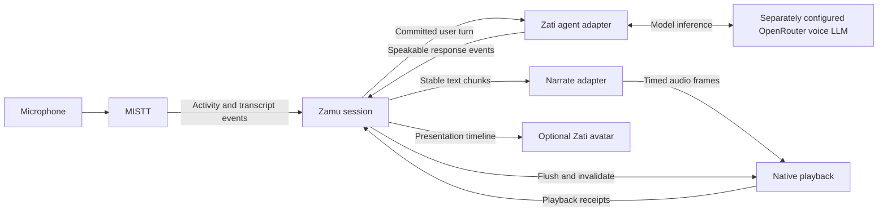

# RFC-001: Zamu — interruptible voice conversations for AI tools

- Status: Phase 1 source implemented, locally verified, reviewed and landed; installed-runtime qualification pending
- Date: 2026-10-13
- First consumer: Zati
- Primary operating environment: Zati macOS desktop, local STT/TTS on DGX Spark, OpenRouter voice LLM
- Implementation language: Go for the embeddable coordinator and adapters; model inference and native audio remain separate runtimes

## 1. Purpose

Zamu gives an existing AI tool a natural voice conversation interface. A person can speak, hear a response, interrupt it, and receive an updated response when they finish their turn. Listening continues while the assistant speaks.

Zamu means “turn.” Its responsibility is conversational coordination: deciding when to yield, when to respond, and which output is still valid. MISTT hears, Zamu coordinates, Narrate speaks, and the host agent acts.

The first integration is Zati's Mac desktop app. Phase 1 delivers English, hands-free conversation through speakers, activated by “Hey Zati” or a click, with thinking-pause tolerance and brief backchannels. Its experience target is the natural voice interaction the owner describes using xAI's GrokBot; no API or implementation compatibility with that product is assumed. Recognition and synthesis run locally on the available DGX Spark. A separately configurable OpenRouter LLM balances response speed and cost.

A reusable Go coordinator and standalone demo establish building blocks for other products. No avatar implementation, renderer selection, MuseTalk integration, or lip-sync qualification belongs in Phase 1. Preserve playback timing and generation identity so a later avatar can follow what the user actually hears.

Zati should feel friendly, attentive, and easy to interrupt. Its identity and friendly system prompt are being developed separately. This RFC defines how voice craft consumes that work without creating a competing persona or changing the authority of the underlying agent.

## 2. Goals and exclusions

### Goals

1. Provide a Go library that can be embedded in Zati and other AI tools without a web UI or mandatory hosted coordinator.
2. Reuse MISTT for listening and transcription, and Narrate for synthesis.
3. Support simultaneous listening and playback, prompt interruption, and automatic turn-taking.
4. Keep the host's existing conversation, tools, permissions, task execution, and memory authoritative.
5. Keep speech local, explicitly disclose the OpenRouter text route, and prevent automatic paid speech fallback.
6. Support long personal sessions with bounded buffering, explicit recovery, and measurable latency.
7. Preserve the distinction between generated text, synthesized audio, and audio actually heard.
8. Preserve timing for a future avatar without implementing it in Phase 1.
9. Provide optional local “Hey Zati” activation, explicit start/mute/stop, speaker echo handling, and tolerant backchannels.

### Exclusions from the first delivery

- A new agent framework, model router, memory store, or task scheduler.
- Training speech or language models, or implementing GPU inference in Go; qualify an existing configurable keyword spotter for the wake phrase.
- A standalone web application, telephony platform, or multi-party meeting assistant.
- Automatic speaker identification, emotional diagnosis, or instructions inferred from ambient conversation.
- Any avatar rendering, lip-sync implementation, or video generation in Phase 1.
- Claims that interruption cancels or reverses external actions.

## 3. Existing building blocks and gaps

These are source observations from the design session, not claims of installed or live acceptance. Dependency revisions must be pinned and rechecked during implementation.

| Block | Observed capability | Required evolution |
| --- | --- | --- |
| MISTT | Go module and gRPC transcription stream; source labels, segment identity, finality, timestamps, session and gap events | Speech activity events; finalized recognition coverage; explicit microphone-only capture mode; conversational latency qualification |
| Narrate | Public OpenRouter speech client returning audio bytes; Pocket workflow with paragraph-level early playback | Public cancellable incremental audio interface suitable for short conversational phrases; persistent local inference adapter |
| Zati | Native speech-start detection, silence-based utterance capture, automatic transcript submission, interruptible playback, Narrate dependency | MISTT input adapter, Zamu session integration, local speech configuration, playback receipts, preserved authority and accounting |
| Spark inference | Deployment target for local models | Qualified simultaneous local STT/TTS configuration with bounded resources and measured OpenRouter reasoning latency/cost |

MISTT's inspected interface does not expose explicit speech-start or semantic end-of-turn events. Its paired microphone/selected-app contract must not be silently treated as microphone-only. Zati's existing native path supplies useful behavior but is not yet a reusable Zamu implementation. Narrate's completed-byte and paragraph workflows do not establish continuous PCM output.

## 4. Architecture and ownership



### MISTT: observation

MISTT owns device capture, source provenance, recognition, and speech activity observations. Its Mac capture owner also supplies echo-processed frames to local wake-word and speech-activity detectors before network transport. Zamu consumes its public interface rather than importing private packages or opening a second microphone capture path.

Required observations are `SpeechStarted`, `SpeechStopped`, `TranscriptUpdated`, `TranscriptFinal`, `RecognitionProgress`, `SessionStarted`, `SessionStopped`, and `Gap`. Speech activity events identify source, session, sequence, and capture time. Transcript revisions retain stable segment identity. Finality means a segment will not change; it does not mean the human has yielded the conversational turn.

`RecognitionProgress` supplies a finalized-through capture offset scoped to the admitted source and stream identity. It guarantees that all recognition results through that offset have been delivered and finalized, including intervals with no recognized text. It must not advance across an unresolved gap. A final segment, the latest transcript timestamp, or elapsed silence alone cannot establish this guarantee. Recognition and activity offsets must share a capture timeline so the coordinator can compare recognition coverage with an endpoint. Adapters that cannot establish complete coverage cannot support automatic turn commitment.

Microphone-only mode must be an explicit MISTT capability with its own admission and tests. Existing paired capture semantics remain explicit. For the first Zati integration, only the admitted microphone source can produce human turns. Other captured audio is not automatically an instruction source.

### Zamu: coordination

Zamu owns turn assembly, endpointing policy, interruption, response generations, queue limits, and conversational playback accounting. It neither executes tools nor maintains a second authoritative chat history.

Turn detection and playback contracts begin as packages in the Zamu module. They do not need independent products or repositories. Provider and host integrations sit behind interfaces so other applications can embed the same coordinator.

### Narrate: synthesis and delivery craft

Narrate converts stable, host-approved speech text into audio. It reports format and timing capabilities and honors cancellation. Its conversational path must not require a new remote rendering job, file transfer, or full-response rewrite for every utterance.

Synthesis should preserve voice continuity across chunks. Chunking balances first-audio latency with natural phrasing; emitting every token independently is not acceptable speech craft.

### Host agent: meaning and authority

Zati owns identity, context, permissions, tool calls, task cancellation, memory, and durable conversation records. Its adapter accepts committed human turns and produces speakable reply events plus task/proposal status. Only content explicitly designated for speech may reach Narrate; reasoning traces, raw tool arguments, and arbitrary internal events are excluded.

Zamu can invalidate a spoken response without cancelling an independent task. The adapter must state whether a cancellation applies to response generation, a proposed action, or a running task. Unknown task outcomes remain unknown.

### Native media adapter

The local media adapter owns speaker output, immediate queue flushing, playback progress, and platform audio integration. Echo cancellation belongs close to capture/playback, where a playback reference is available. Muting input and stopping output are separate operations.

## 5. Proposed Go contracts

The following is an API sketch, not implemented source or a frozen compatibility commitment:

```go
type Components struct {
    Listener Listener
    Turns    TurnDetector
    Agent    Agent
    Speech   Synthesizer
    Player   Player
    // Future presentation consumers subscribe to playback events.
}

func New(cfg Config, deps Components) (*Session, error)
func (s *Session) Run(ctx context.Context) error
func (s *Session) Events() <-chan Event
func (s *Session) Interrupt(ctx context.Context) error
func (s *Session) Close(ctx context.Context) error
```

Construction performs validation only. Explicit start owns I/O and goroutines. Cancellation closes owned resources within a configured deadline and reports incomplete cleanup. Every stream has an explicit terminal result; channel closure alone cannot ambiguously represent success or failure.

| Boundary | Input | Output / guarantees |
| --- | --- | --- |
| Listener | Authorized capture subscription | Ordered activity/transcript events, revisions, finalized recognition coverage, gaps, terminal result |
| TurnDetector | Activity, transcript context, elapsed silence | Provisional endpoint, revoked endpoint, committed turn; reasons and confidence where meaningful |
| Agent | Turn ID, text, conversation binding, prior playback receipt | Response ID, stable speech text, completion/failure, host-owned task status |
| Synthesizer | Response generation, ordered stable text chunks, voice craft | Bounded audio frames, explicit format, optional text/audio alignment, terminal result |
| Player | Audio frames, generation, pause/resume/flush controls | Actual playback cursor, acknowledged pause/resume/flush, completion |
| WakeDetector (native MISTT extension) | Echo-processed local PCM while armed | Wake detection span, source and capture identity; no authority to submit turns |

Audio format includes encoding, sample rate, channels, and sample count. Adapters negotiate or explicitly resample; they never reinterpret bytes at a different rate. Core playback uses timestamped PCM frames. Transport compression may be an adapter concern.

Events carry session ID, turn ID where applicable, response generation, sequence, and a monotonic media offset. Wall-clock time may be included for diagnostics but is not the synchronization clock. Typed errors distinguish unsupported capability, authorization failure, overload, transport failure, and uncertain provider execution.

## 6. Turn-taking and interruption

Listening remains active across all output states. Output progresses through idle, generating, speaking, provisionally paused, interrupted, completed, or failed. The listener has its own lifecycle; a single state enum must not make listening and speaking mutually exclusive.

### Normal turn

1. Admit the explicitly started voice session and selected microphone source.
2. Assemble partial/final transcript revisions without duplicating text.
3. Detect a candidate end of turn from speech activity and context.
4. Revoke the candidate if speech resumes before commitment.
5. Wait for finalized recognition coverage through the candidate endpoint, with no unresolved gap in the utterance. Speech resuming during this wait still revokes the candidate.
6. Commit the complete finalized text as one user turn with a stable ID and submit it once to the host.
7. Synthesize stable reply chunks while the agent continues generating.
8. Play ordered audio and report heard progress to the host.

The first detector may use configurable silence and transcript context. A semantic detector is pluggable. Model-assisted endpointing must have a bounded deadline and an explicit fallback policy. Silence alone is not proof of completion in every case; unfinished phrases, hesitations, and deliberate pauses belong in acceptance fixtures.

Endpoint acceptance and transcript completeness are separate prerequisites for commitment. The recognition wait has a configured deadline; expiry invalidates the uncommitted utterance and requests a repeat rather than submitting partial text. Late results for an invalidated utterance are quarantined and cannot enter the next turn. A result that changes text already covered by a finalized-through offset is a listener contract failure: suspend automatic commitment and report it to the host. Do not silently edit or resubmit an already committed turn; host-owned actions may already have begun.

### Tolerant endpointing and interruption

Use speech activity plus transcript context; do not carry over Zati's fixed 750 ms silence cutoff or 15-second utterance cap as the conversational policy. Initial tunable defaults are 900 ms silence for a complete thought and 2.5 seconds for an unfinished phrase. A local detector can extend a thinking pause to five seconds before asking a brief clarification rather than submitting an obviously incomplete instruction. Set a 120-second utterance limit with an explicit “please continue” boundary; never silently truncate or auto-submit an incomplete turn. These are implementation starting values, subject to the acceptance fixtures below, not measured optimal thresholds.

1. Echo-processed local speech activity immediately requests a provisional playback pause, without waiting for Spark, OpenRouter, or the Go controller. Record the acknowledged played cursor; keep the generation valid while classification is pending.
2. A local interruption classifier distinguishes a clear interruption (such as “wait” or “stop”), substantive speech, a brief acknowledgement, and noise. Use local keyword detection for urgent stop words and bounded local recognition/context for ambiguous cases. Do not make an OpenRouter call for each noise event or backchannel.
3. A confirmed backchannel such as “mm-hmm” during an answer resumes the same generation from the acknowledged cursor only after its speech span has closed, recognition coverage has finalized that span, and no following speech is active. An interim “yeah” is insufficient. Record a backchannel disposition for that exact capture span; only its text is excluded from turn assembly, while subsequent speech remains eligible input. Mixed input such as “yeah, but stop the upload” is substantive and must reach the host intact. A confirmed standalone backchannel creates no new host turn, approval, or tool call. “Yeah” is contextual: when answering an explicit question or approval prompt it is ordinary human input through the host's existing rules, not automatically suppressed as a backchannel.
4. Confirmed interruption or classifier timeout invalidates the generation, flushes pending audio, and cancels obsolete speech/response production where supported. Unknown input conservatively yields; it never automatically resumes. Default classification deadline is 1.6 seconds from the provisional pause. The initial 700 ms proposal was increased after the CPU qualification measured approximately 0.51–0.65 seconds of recognition alone (1.065 seconds alongside synthesis), before accounting for acknowledgement duration and native activity detection. This is a tunable starting value, not a measured backchannel p95 guarantee. A resumed answer cannot repeat already played samples.
5. Continue assembling substantive speech and apply the transcript-completeness barrier before submitting the next turn. Late audio, text, classification results, or resume acknowledgements from an invalidated generation are rejected. Classifier events carry the pause token, capture span, and generation so an older result cannot resume a newer pause.
6. The host updates its response from the new input and heard progress. Independent tasks continue unless the user's words request cancellation or a change through the host's normal authority path. Closing a provider stream does not establish stopped compute or billing.

Explicit interruption controls bypass provisional classification and invalidate immediately. An answer interrupted by substantive speech is not automatically resumed; “keep going” is interpreted by the host. For backchannel pauses, bound retained PCM to two seconds and apply backpressure upstream. If that bound cannot be maintained, invalidate and report the interruption instead of silently dropping audio and then resuming.

### Wake-word activation and session controls

Phase 1 includes “Hey Zati”, with a visible enable/disable setting and click-to-start available. Default wake detection is disabled until the owner enables it and microphone permission is granted. States are off, armed, active, muted, and unavailable; playback has its separate state machine. Armed means local keyword detection only, not an active conversation or continuous remote transcription.

The selected implementation uses Apple on-device English recognition for local “Hey Zati” and urgent-stop detection, with mandatory on-device capability checks and `requiresOnDeviceRecognition`. It fails unavailable when that capability is absent. Record the target Mac/OS identity and qualify phrase matching, false wakes, rotation and CPU use before daily-use acceptance. The initial sherpa-onnx keyword-spotter proposal was replaced during implementation; see section 16. Neither unavailable local detection nor a failed qualification permits cloud listening.

MISTT remains the only microphone owner. Mode arbitration must reject an incompatible already-active paired capture session with an explicit busy state; do not silently repurpose it, mute another consumer, or label capture as local-only while that session forwards microphone audio. Add a native local-only armed mode and an authenticated wake event/control path, not a second Zati capture engine. Armed PCM is processed on the Mac in a bounded two-second volatile ring, never written to disk or sent to Spark or OpenRouter. A wake event identifies the end of the wake phrase; retain trailing command audio so “Hey Zati, what's next?” loses no words. Admit the current actor and selected conversation before forwarding only post-phrase audio to STT. If detection cannot locate a reliable boundary, acknowledge readiness and ask for the command rather than submit an uncertain fragment. Bound audio held during admission to two seconds; on overflow request a repeat.

Wake detection is suspended while the session is active. Use the echo-cancelled capture path and test assistant playback of the phrase during armed transitions. The wake phrase is activation, not speaker authentication or permission to execute tools. Missing conversation selection, logout, screen lock, or expired admission must not activate a conversation. Conversation switches end the existing voice session; a new explicit start or wake is required against the new binding.

Click Stop returns an enabled wake detector to armed; disabling wake detection turns capture off. Mute suppresses both wake detection and recognition and cannot be undone by voice; output stop remains a separate control. Muting during an active session preserves its binding but discards uncommitted input. Unmute returns to that binding only if still valid; otherwise it returns to armed/off. Lock, logout, and permission loss tear down capture and require explicit rearming after recovery. Default idle timeout is five minutes without user speech while the assistant is neither speaking nor awaiting an answer; return to armed/off. Long host tasks may continue under host policy. Show the resulting state clearly.

Spark loss makes active voice unavailable, flushes output, and leaves text chat usable. The armed local detector may remain available, but activation reports speech unavailable until health checks pass; it must not queue commands for later execution. No automatic hosted STT/TTS fallback. Returning health requires a fresh start/wake and admission, not replay of buffered speech.

### Playback truth

Track generated, synthesized, queued, and played progress separately. Word-level heard text requires alignment evidence. Without alignment, report phrase boundaries or sample progress with declared uncertainty. Preserve the complete generated record if the host needs it, but do not represent unheard text as successfully delivered.

## 7. Friendly Zati and voice craft

Zati's host-owned persona remains the single source of identity and conversational behavior. The parallel system-prompt work supplies a versioned voice-compatible style contract; Zamu and Narrate consume it rather than maintaining another system prompt.

Separate three concerns:

- **Content craft, owned by Zati:** friendly wording, concise spoken answers, relevant acknowledgements, useful follow-up questions, and honest descriptions of work.
- **Delivery craft, consumed by Narrate:** voice identity, pronunciation, pace, pauses, warmth, and supported prosody instructions.
- **Interaction craft, owned by Zamu:** yielding promptly, allowing thinking pauses, avoiding repeated greetings, and recovering gracefully from interruptions.

The Phase 1 voice is Pocket TTS **Anna**, matching the owner-selected Zati videos recorded in `ltx-spark/ajent.social` on 2026-10-09. Reuse the actual Anna preset and pin its asset/model revision during preflight; do not infer a stock voice identifier from the display name or substitute another preset silently. Video production proves prior selection, not conversational streaming quality. The style contract should carry a revision, English language, Anna voice identity, pace preference, pronunciation overrides, and supported delivery hints. Provider capability negotiation must identify unsupported hints rather than pretending they were applied. Do not create an emotion-inference requirement from microphone input.

Default conversational behavior:

1. Use natural, brief openings; give the useful answer early.
2. Prefer speech-sized phrases and offer more detail when appropriate.
3. After an interruption, address the new input without scolding, repeated apologies, or restarting the entire answer.
4. Avoid filler on every tool call. A short status acknowledgement is appropriate only when grounded in actual host state.
5. Preserve exact amounts, names, approvals, and execution outcomes. Voice polish must not change their meaning.
6. Do not vocalize Markdown syntax, raw URLs, stack traces, or large tables by default; the host supplies an appropriate spoken form while retaining the original visible content.
7. Keep synthetic identity honest. Friendly presentation does not authorize claims of human feelings, experiences, or completed actions.

Verbatim text and approval prompts can disable rewriting. Style changes are pinned per response, preventing a mid-utterance persona or voice switch. The prompt session and voice implementation should agree on sample exchanges covering greeting, useful disagreement, interruption, uncertainty, errors, and tool progress before persona acceptance.

## 8. Future talking Zati avatar

This entire section is future scope. Phase 1 only preserves playback receipts, sample offsets, response generations, and a nonblocking event subscription; no Presenter implementation or avatar dependency is required. Avatar support is a presentation extension of the same session, not a separate conversational agent. The voice-only path ships first, but its event schema must preserve the timing needed for a convincing avatar.

### Presentation contract

Expose listening, thinking, speaking, interrupted, idle, and unavailable states, plus optional host-approved expression hints. States report actual activity: “speaking” begins with playback, not when synthesis starts.

Audio playback is the master clock. Audio frames carry sample offsets and response generation. Optional alignment associates text, phonemes, or visemes with intervals on that timeline. If the TTS backend lacks alignment, a separate audio-to-viseme adapter may provide it; text alone cannot establish exact mouth timing.

Every visual cue carries the same generation fence as audio. On interruption, flush pending speech animation and transition to listening at the acknowledged playback stop. Buffering pauses the mouth timeline; resumed playback resumes from the actual cursor. Dropped visual frames must not delay audio or accumulate stale animation.

### Progressive implementation

1. **Stateful avatar:** attentive listening, thinking, and speaking states with restrained expressions. This is not claimed as lip sync.
2. **Synchronized avatar:** visemes driven by synthesized audio/alignment and the actual playback clock.
3. **Richer rendering:** optional higher-fidelity face or video generation, admitted only when it meets latency and resource limits alongside the voice models.

The renderer may live in Zati's native UI or a separate process. Zamu remains usable without graphics dependencies. When the avatar fails or exceeds its budget, degrade to voice with an idle/static visual. Never hold a spoken answer waiting for a video render.

Visual acceptance requires watching and listening to the actual output, including interruptions. A present animation file, running renderer, or generated viseme list is not evidence of convincing lip sync. Provide motion-reduction and voice-only options.

## 9. Phase 1 backend and cost profile

| Component | Phase 1 placement and route |
| --- | --- |
| Capture, AEC, wake detector, immediate pause/stop | Mac, in the single MISTT native capture/media integration |
| Recognition | MISTT to a persistent local Spark service |
| Turn/backchannel coordination | Zamu locally, with bounded local detector/recognition assistance |
| Reasoning and tools | Zati host, separately configured OpenRouter voice LLM |
| Synthesis | Narrate public streaming adapter to persistent Pocket TTS on Spark, Anna preset |
| Playback | Zati native Mac output with actual cursor and pause/resume/flush receipts |

This is a hybrid profile: audio and speech inference remain local, while committed text and the host-authorized conversation context reach OpenRouter. The UI discloses that boundary before enabling voice. Host tools and memory retain their own disclosure and permission rules. “Local speech” must never be labeled “fully offline”.

Add `voice.reasoning_model` separately from chat model selection and the existing OpenRouter speech-provider connection. It selects the host's ordinary OpenRouter reasoning route with normal permissions, tool capability checks, token accounting and request limits. Pin the selected model for each response; changing settings applies to the next response. No per-turn model chooser or parallel persona/history. A short qualification task selects an available model by measured first-token latency, tool/permission fidelity, spoken quality, and cost per representative session, then records its exact ID, provider routing and current price. The RFC deliberately does not hardcode an unmeasured model winner.

Bound context and response tokens using host policy; disclose estimated and actual LLM usage and enforce its existing spending limits. Do not add hosted endpointing calls for each partial transcript. An exhausted budget or unavailable model produces an honest failure, with no silent switch to a more expensive route. Interrupted requests may still be billable.

Keep STT and TTS warm during active sessions, with resource limits and health checks. Manage pinned services using the owner's approved Spark workload mechanism. Zamu does not install models or displace unrelated GPU jobs. Qualify STT and TTS concurrently with representative Spark load; no local LLM reservation is required for Phase 1. The selected conversational recognizer is pinned Whisper base.en behind MISTT's additive microphone API. Its bounded CPU probe results are recorded in section 16 and the delivery receipt; they do not establish end-to-end conversational p95. Existing paired recognition remains compatible.

The existing Anna video path and Narrate batch runner do not prove persistent incremental audio. Qualify Pocket streaming on ARM64, including cancellation, continuity, first-frame latency and sustained delivery. Pocket's upstream documents CPU execution and streaming; placement on Spark must still pass concurrent-load measurements. [Pocket TTS](https://github.com/kyutai-labs/pocket-tts).

A fully local LLM profile and explicitly hosted speech adapters remain later options. They do not block Phase 1. Hosted utterance transcription must not be represented as continuous recognition. If Spark fails, pause voice, preserve text chat, and show the local service error; recovery never initiates a paid speech call.

## 10. Zati integration

Zati embeds Zamu in the appropriate local runtime and connects native playback through its authenticated local transport. Keep the immediate media stop path local even if the agent controller is remote. Integration replaces the existing voice path incrementally, avoiding two simultaneous microphone owners.

Preserve current voice-session admission, conversation/generation binding, dedicated provider credentials, disclosure rules, accounting, and reply commitment semantics. A local backend needs an explicit configuration path; it must not be disguised as an OpenRouter credential or bypass checks through a fake endpoint.

Automatic turn submission is permitted only within a voice session activated by click or an enabled wake event, then admitted and bound to the selected conversation and actor. Duplicate/replayed events cannot create repeated messages or tool execution. Scope changes, logout, and session expiry close admission and invalidate pending outputs.

Use the host's existing reply stream where possible. Preview text may be spoken only according to the host's explicit policy, with withdrawal and commitment semantics preserved. Zamu must not turn provisional output into a durable message or action approval.

## 11. Reliability, privacy, and resource limits

- Bound every audio/text queue by duration or bytes. Slow consumers trigger backpressure or explicit failure; never silently lose a committed human turn.
- On a transcript gap, pause automatic turn commitment and mark every overlapping uncommitted utterance as incomplete. Reusing an affected utterance requires recovery of the entire missing interval and finalized recognition coverage through its endpoint within a configured recovery deadline. Resumed events alone do not repair the gap. If recovery is unavailable or times out, invalidate the affected utterance, clear or quarantine its text and pending endpoint, and explicitly request a repeat. Resume assembly only at a fresh speech boundary after continuity is established; never concatenate pre-gap and post-gap fragments into a new instruction. After an unrecoverable gap, establish a new stream identity and capture baseline before resuming automatic commitment; old-stream events cannot advance its coverage. Fresh session admission must also clear or quarantine partial turns from the old stream. Do not fabricate missing words.
- Reconnect with new stream identity and explicit sequence reconciliation. Partial transcripts and tool submissions are not blindly replayed.
- Set maximum session and utterance durations. Long sessions use verified rollover or explicit renewal; bounded teardown must not produce duplicate final turns.
- Keep raw audio and transcripts out of default diagnostic logs. Retention is host-controlled and explicitly configured.
- Use explicit authenticated endpoints and credentials. No ambient credential discovery or cloud fallback in the core.
- Separate cancellation from retry safety. Ambiguous hosted calls may have executed and incurred cost; do not automatically repeat them.
- Avoid per-turn process/model startup. Release session resources on close while respecting separately managed shared inference services.

## 12. Acceptance and measurements

The numbers below are proposed engineering targets, not measured claims. Capture p50/p95, hardware/model configuration, network conditions, and failures. Report raw traces with distinct endpointing, inference, synthesis, and playback intervals.

| Area | Acceptance condition |
| --- | --- |
| Basic loop | “Hey Zati” and click start each admit a real Mac speaker conversation through MISTT, the separate OpenRouter reasoning model, and local Anna synthesis |
| Interruption | Speech-start event to confirmed playback stop targets p95 <= 150 ms on the local device; separately measure acoustic onset to detection |
| Turn response | Acoustic end of turn to first audible response targets p95 <= 1.5 s for short, non-tool turns on the selected warm hybrid profile, including OpenRouter network latency |
| Stale output | No old-generation audio or avatar cues are accepted after flush acknowledgement |
| Endpointing | At least 40 English fixtures include 1–3 second thinking pauses, unfinished sentences, and resumed speech; zero premature submissions in the designated pause fixtures, at least 95% of complete short turns produce a response within the selected timing policy |
| Backchannels | At least 30 labelled acknowledgement/noise/interrupt fixtures: at least 90% of true backchannels resume correctly, zero clear “wait/stop” examples resume, and no duplicate played audio, accidental approvals or new turns for swallowed acknowledgements; include “yeah” as an answer to an explicit question and “yeah, but stop the upload” as an intact substantive turn |
| Wake word | At least 50 owner-spoken activations at desk distance: at least 95% detected, p95 detection-to-ready <= 500 ms with warm services; two hours of negative room/playback fixtures have zero false activations. Report sample counts and limits, not a population accuracy claim |
| Session controls | Mute, stop, wake-disable, lock, logout, conversation switch, admission expiry and idle timeout exhibit the specified capture and binding behavior; inline commands lose no post-wake words |
| Transcript completeness | Delayed final segments and coverage events never permit premature submission; resumed speech revokes an endpoint while coverage is pending. Deadline expiry submits nothing and requests a repeat. Late results cannot contaminate a later turn, and revisions behind finalized coverage produce a contract failure without resubmission |
| Gap integrity | Inject a missing negation or condition mid-utterance. Resumed events alone never submit the remaining fragments; only verified complete recovery permits the original turn. Unrecoverable gaps request a repeat, and reconnect or fresh admission cannot reuse the affected text or endpoint |
| Agent authority | Interrupting speech never falsely reports tool cancellation; explicit cancellation uses the host's normal path |
| Heard context | Interruption receipts distinguish played and unheard output, with timing granularity stated |
| Session endurance | A two-hour conversation soak exercises configured renewal/rollover, repeated interruptions, bounded queues, and clean shutdown without monotonic session-owned resource growth |
| Speech locality | With STT/TTS services denied external egress after preparation, speech still works with the explicitly allowed OpenRouter host route; armed capture sends no audio off the Mac. Blocking OpenRouter fails reasoning honestly rather than claiming offline operation |
| Recovery | STT/TTS/LLM loss produces an honest state and bounded cleanup; reconnect cannot duplicate a user turn or external action |
| Audio environment | Mac speakers must pass before Phase 1 release: echo-processed recognition, no self-wake or repeated self-interruption; headphones are a diagnostic path, not a substitute |
| Friendly craft | Owner listens to representative exchanges and accepts warmth, pace, clarity, interruption recovery, and consistency with the host persona |
| Future avatar extension | Outside Phase 1: visible/audio review demonstrates mouth alignment, buffering behavior, interruption, stale-cue rejection, and voice-only fallback |

Use deterministic event/clock tests for races, revisions, and generation fences; adapter contract tests for real wire formats; then actual microphone-to-speaker qualification. Passing simulated tests does not establish provider latency, native audio, or human acceptance.

## 13. Delivery sequence

This is architectural sequencing, not a governed implementation plan or authorization to deploy.

1. Pin source and model/preset revisions; qualify local wake/stop detection, STT completeness, Anna streaming, and a low-cost OpenRouter reasoning model. Freeze additive integration contracts and persona handoff.
2. Implement Zamu's session state, event contracts, turn assembly, cancellation, generation fences, and playback receipts with deterministic fixtures.
3. Add MISTT speech activity, finalized recognition coverage, and microphone-only support and Narrate's public incremental local synthesis interface; qualify their narrow paths.
4. Integrate Zati Mac and a standalone Zamu demo with local Spark speech, separate OpenRouter reasoning, “Hey Zati”, native pause/resume, and interruptions.
5. Qualify thinking pauses, backchannels, wake controls, Mac speaker echo handling, long sessions, recovery, and friendly Anna delivery; measure latency and OpenRouter cost.
6. Later phases may add fully local reasoning or explicit hosted speech adapters.
7. Avatar rendering and synchronization await a separate design decision after the owner investigates options such as MuseTalk.

Each step preserves source, contract, runtime, and human acceptance as separate evidence. No milestone is complete solely because source compiles or a UI control exists.

## 14. Decisions and remaining choices

### Decisions established by this RFC

- Name: Zamu; embeddable Go library; first consumer: Zati.
- Reuse MISTT and Narrate rather than creating replacement speech products.
- Phase 1 uses local STT/TTS on Spark and a separate configurable OpenRouter voice reasoning model.
- “Hey Zati”, click start, mute/stop, English, Anna, speaker use, thinking-pause tolerance and backchannel pause/resume are Phase 1 requirements.
- MISTT and Narrate evolve additively; existing paired capture and batch speech consumers remain supported.
- The host agent retains identity, memory, tools, and authority.
- Friendliness spans host wording, synthesis delivery, and interruption etiquette.
- Avatar timing is designed into events now; rendering is optional and delivered later.

### Choices to settle through integration and measurement

- Exact recognition and wake model revisions, Anna preset asset identity, and low-cost OpenRouter model/provider selected by bounded preflight.
- Turn detector and language coverage; silence thresholds and semantic fallback behavior.
- Measured Spark CPU allocation for TTS and local detector thresholds; immediate pause/stop and wake detection remain on the Mac.
- Exact additive schemas and migration generated from Zati contract sources; Phase 1 supports macOS.
- Final voice-craft schema agreed with the parallel system-prompt session.
- Avatar renderer, alignment provider, likeness, and visual style.

Preflight tasks must resolve these choices and pin exact artifacts before dependent implementation or runtime acceptance. They do not justify bypassing host boundaries or claiming compatibility before qualification.

## 15. Inspected integration baseline

Read-only source inspection on 2026-10-13 established the following baseline. No installed behavior, latency, or model capacity was tested. Recheck heads and generated contracts before implementation.

| Repository/revision | Evidence and required change |
| --- | --- |
| MISTT `4a66e95117cb2ae24fd25731bf717eee1679f0b4` (locally available `origin/main`) | `proto/mistt/v1/mistt.proto`: paired subscription, segment identity/finality, source timestamps, session gaps; no speech activity, finalized coverage, wake events or microphone-only subscription. `desktop/README.md`: native capture owns paired microphone/app audio, normalizes PCM to 16 kHz, uses bounded IPC. Add compatible source modes and native local detectors. The primary checkout is older (`c776f25e6b1ceef7c45f9bb4f2f39dcbbcb7b13f`); do not implement against it accidentally. |
| Zati `5a2f1f281c4a42e036f40f312e01d4e8433d4b41` | `apps/desktop/macos/Runner/MainFlutterWindow.swift`: `zati/voice` bridge, Apple voice processing/AEC, fixed silence and utterance limits, whole-file playback, destructive interruption, focus-loss shutdown. `apps/desktop/lib/src/ui/voice_mode.dart`: busy utterances can be discarded; replace this with bounded turn handling. Keep the existing governed `prepareMessageSend` entrypoint. |
| Zati host at same revision | `internal/voice/service.go`, `internal/connections/voice.go`: dedicated hosted speech route and accounting, not a voice reasoning profile. `internal/execution/controller_ops.go` uses `profile.Model`; introduce voice-scoped reasoning selection without changing background worker profiles. Update authored spec inputs in `docs/implementation` and `tools/specgen/model.py`/`packages.py`, then regenerate contracts rather than hand-editing generated artifacts. |
| Narrate `29bc740031c8b26ca68a2d79e9702d5d91e7bb84` | `speech/openrouter/client.go` exposes bounded whole-result calls; `internal/pocket/pocket.go` uses remote subprocess/file rendering. README `--stream` is paragraph-file playback. Add a public persistent PCM API beside these existing interfaces; preserve CLI and batch consumers. |
| ltx-spark `64d2200f8f089c366c3a5f3cdd3163b3a0da4d41` plus local handoff record | `ajent.social` records the owner's Anna selection and completed Zati video on 2026-10-09. The maintained `zati-video` skill identifies the validated Pocket Anna preset and 24 kHz mono source audio. Pin the concrete preset asset from its production receipt; do not reuse video rendering or SSH/file orchestration for conversation. |

The Mac migration must transfer microphone ownership from Zati's existing native capture to MISTT without losing AEC. Place duplex capture/playback reference handling in the native MISTT integration and expose controls/receipts to Zati. Preserve speaker output in the native media boundary and prove the reference reaches the capture owner. Simply turning on AEC in the old capture engine while opening a different MISTT microphone does not satisfy this requirement. Keep legacy paired capture as the default for existing clients; introduce versioned/additive microphone-only and armed-only capabilities, reject unsupported requested modes explicitly, and test old clients against the upgraded service.

Window focus loss alone must not terminate an explicitly armed wake detector or active conversation. App quit, lock, logout, permission loss and explicit controls retain the teardown behavior above. Show armed/active/muted/unavailable status even when the main window is unfocused. Native packaging must include the local detector and use the existing permission/signing workflow.

Expose additive player commands `Pause(generation, token)`, `Resume(generation, token)` and `Flush(generation)` with acknowledged rendered-sample cursor, format and terminal outcome. Serialize commands with audio admission; resume must match the still-valid paused generation/token. For Phase 1 use 16 kHz mono PCM16 capture and the pinned Anna service's native PCM format (expected 24 kHz mono), explicitly resampled at playback. Cap queued playback at two seconds, pending committed turns at four, and stable unsynthesized response text at 16 KiB. On overload surface a recoverable state and retain/report each committed turn's disposition; do not silently drop it as the existing busy path can. Runtime defaults remain configurable and are recorded with acceptance traces.

The standalone `examples/conversation` demo uses the same public coordinator, MISTT, Narrate and media contracts with a minimal OpenRouter host adapter. It demonstrates wake/start, English speech, pause/resume, interruption, heard receipts and failure recovery without importing Zati internals or an avatar framework. It executes no tools; it is a reuse check, not a replacement host agent.

## 16. References

- MISTT: `github.com/sirerun/MISTT`, especially `proto/mistt/v1/mistt.proto` and the capture contracts.
- Narrate: `github.com/narrate-it/narrate`, especially `speech/openrouter` and the Pocket streaming workflow.
- Zati: `github.com/zati-run/zati`, especially `internal/voice`, desktop voice mode, and native playback.
- [Unmute](https://github.com/kyutai-labs/unmute): reference for speech orchestration and interruption behavior.
- [Pocket TTS](https://github.com/kyutai-labs/pocket-tts): candidate local streaming synthesizer; upstream capabilities require target-host qualification.
- [OpenRouter transcription](https://openrouter.ai/docs/guides/overview/multimodal/stt) and [speech synthesis](https://openrouter.ai/docs/guides/overview/multimodal/tts): optional hosted adapter boundaries.


## 16. Phase 1 implementation decisions

The native local detector uses Apple's on-device English speech recognition with
`requiresOnDeviceRecognition` and explicit capability checks. The initial
sherpa candidate was not required to obtain the selected local Mac behavior.
Unavailable on-device assets make voice unavailable; they never authorize cloud
recognition. The native engine supplies the playback echo reference and owns an
exclusive capture lease shared with existing paired capture clients.

Mute preserves playback and host admission. Unmute joins the old recognition
stream, establishes a fresh stream identity and capture baseline, then applies
`CaptureReset` under the original binding. Native capture epochs fence delayed
pre-mute callbacks. Silence checkpoints follow the native VAD decision, never an
audio-only timer that could finalize the first frame of newly started speech.

A synthesis callback owns one bounded PCM frame until admission; the coordinator
copies it before asynchronous playback work so cancellation permits safe producer
buffer reuse. Frame-write backpressure cannot block capture/control processing.
The default stable-phrase queue holds at most 64 phrases and still enforces the
16 KiB aggregate unsynthesized text limit. At most four host response calls remain
outstanding; further input receives an explicit rejected-turn disposition.

See `docs/qualification.md`, `docs/benchmarks.md` and the delivery ledger for
observed component evidence and the still-separate installed/human acceptance.
